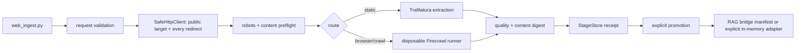

# Web-Ingestion M2–M5 设计

**状态：** 用户已批准实施。
**范围：** `.`；不改变 Hermes、Open WebUI、MCP、既有 RAG 或既有容器服务。

## 1. 目标状态

建立一个唯一、显式、按需的 `web_ingest.py` 入口。每次采集都必须携带 URL、用途、模式、页数预算、超时与 staging 根目录；入口先做公网/重定向/robots/内容类型准入，再选择受限路由，写入无正文 receipt。只有独立的显式 promotion 才能跨越 staging；RAG bridge 只定义可审计、内存载荷校验的 adapter 合约，默认不配置任何真实 RAG sink。

## 2. 结构

- `web_ingestion.py` 是控制器：输入契约、受控 HTTP preflight、robots、路由、质量、去重与 stage receipt。
- `web_ingest.py` 是唯一用户 CLI；Firecrawl 场景由它内部调用既有的隔离 runner，用户不直接调用 API。
- `rag_bridge.py` 是独立数据面。它接受已 promotion 的 receipt 与内存中的、digest 一致的内容；默认只生成 bridge manifest，不接入真实 RAG。
- `scripts/firecrawl-isolated-benchmark.sh -- <command>` 仅增加受控 command-vector 模式，继续使用既有临时 Redis/RabbitMQ/Compose 与 trap 清理。
- `scripts/verify-firecrawl-provenance.py` 在启动前比对清单、provenance、image tag、架构与本地 image ID。

## 3. 路由与边界

| 请求模式 | 默认路由 | 原因 | 不允许 |
| --- | --- | --- | --- |
| `static` | 安全 HTTP transport + Trafilatura | 文档/静态正文的最小运行面 | 原始全局 crawler、正文落盘 |
| `browser` | Firecrawl disposable service | 已验证 JS 采集与 loopback 服务边界 | 常驻 API、直接 API 调用 |
| `crawl` | Firecrawl disposable service | 已验证十页单并发 crawl | 超过 10 页、非公开/robots 拒绝目标 |

Crawl4AI、Crawlee、Scrapy+Trafilatura 的 M1 准入结论不改变；本 M2 入口只启用能由控制器完整守住当前 egress/数据边界的路线。Crawlee 的 crawl-delay 条件仍是未来递归路线的硬门。

## 4. 数据与 promotion

- receipt 仅含 URL、用途、时间、route、digest、质量指标、robots/policy 决定、预算与审计字段；禁止正文、HTML、Markdown、raw response。
- 同一 stage root 中 content digest 已存在时，新记录标为 `duplicate`，不得 promotion。
- `StageStore.promote(..., explicit_confirmation=True)` 是唯一 promotion 入口。
- RAG bridge 的真实 delivery 只接受一个显式 adapter 和内存载荷；digest 不一致、未 promotion、未确认、或默认未配置 sink 都 fail closed。

## 5. 供应链与运行

- 默认 Firecrawl 运行集继续使用审查过的 GHCR arm64 manifest、已验证 image ID、`pull_policy: never` 与临时服务。
- 每次 Firecrawl 运行前验证 `ops/firecrawl-images.json`、`ops/firecrawl-provenance.json` 与本地 images；不匹配即退出。
- rollback 是停止/清理临时运行面并回到上一份审查清单；任何 tag/digest/Compose/暴露面变化都必须重跑 M1/M3 验收。

## 6. 验收

1. URL、用途、模式、预算与 timeout 缺一即 CLI 拒绝。
2. 私网、嵌入凭据、重定向到私网、robots 禁止、错误类型与超过预算均 fail closed。
3. static、browser、crawl 三条路径写出无正文 stage receipt；同内容第二次被标为 duplicate。
4. promotion 与 RAG bridge 需要独立 `--confirm`；桥接 contract 在真实 sink 缺席时不写任何 RAG。
5. Firecrawl 启动前 provenance 验证、命令失败 cleanup、资源/监听/清理证明均可复跑。
6. Python 3.12、3.13、3.14 锁定矩阵通过；所有临时 runtime 与虚拟环境清理。
